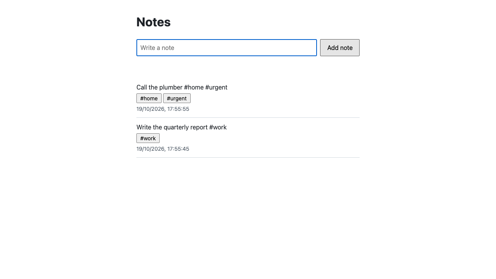
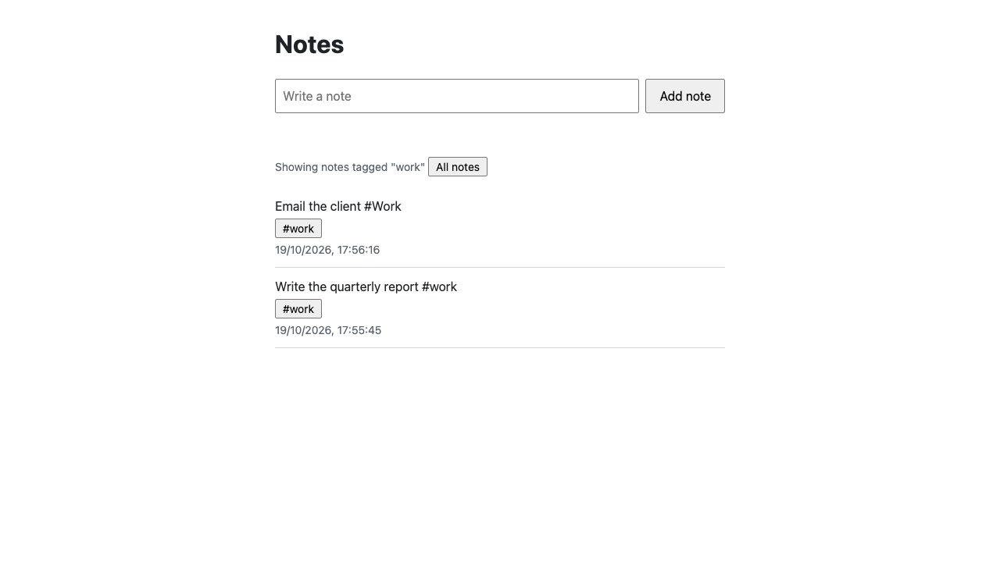

# Walkthrough: one real change, end to end

This is a real run of `/falsifiable:ship` on the example's proposed change, `add-note-tags`, taken from its logs on 19 October 2026. Quotes are from the agents' reports, the briefs and the hook's messages; long ones are cut where marked with "…". Nothing is tidied.

**The outcome.** Verify came back `verified`. Both product scenarios passed in a real browser, run by a verifier that never saw the code. The regression sweep found nothing. The review found nothing that blocks (one P2, two P3). Nothing was pushed, because the scratch repository had no remote.

| | |
|---|---|
| Plugin | this repository at commit `75acd56`, loaded with `--plugin-dir` |
| Claude Code | 2.1.303, model `claude-opus-5-5` for the head and every agent |
| Agents | 5: planner, 2 builders, verifier, reviewer |
| Cost | US$6.46, the session's `total_cost_usd` as Claude Code reported it |
| Stages | plan, build, verify; no fix round was needed |
| Time | 19 minutes from the first prompt to the hand-over |

## Setup

```bash
cp -R examples/notes-app <scratch>/notes-app && cd <scratch>/notes-app
git init -b main && git add -A && git commit -m "notes app"
git switch -c change/add-note-tags

CLAUDE_CODE_PRINT_BG_WAIT_CEILING_MS=0 claude -p --plugin-dir <falsifiable> \
  --strict-mcp-config --mcp-config mcp.json \
  --output-format stream-json --verbose \
  --allowedTools Workflow Agent Bash Read Write Edit Glob Grep mcp__playwright \
  --append-system-prompt "<the unattended instructions below>" \
  '/falsifiable:ship add-note-tags'
```

`mcp.json` gives the verifier a browser it can drive with nobody at the screen. Its name holds `playwright`, so the default `verify.mcpServers` allows it:

```json
{ "mcpServers": { "playwright": { "command": "npx", "args": ["-y", "@playwright/mcp@0.0.69", "--headless", "--isolated", "--output-dir", "<scratch>/playwright-output"] } } }
```

The unattended instructions told the head: "Ship the change through every stage of the ship skill. When a brief asks for a decision, take the option you recommend, record it under Decisions in the change design.md as the skill says, and go on. Before the verify stage, start the app yourself from the change branch with `npm start` in the background … The repository has no git remote: stop before any push or pull request …"

## 1. Plan: `needs-decision`, 1 agent

The planner split the change into two lanes, with both contracts (the note shape and `GET /api/notes?tag=<tag>`) owned by `note-tags-api`:

| Lane | Domain | Owns | Scenarios it serves |
|---|---|---|---|
| `note-tags-api` | api | `server.mjs`, `test/**` | Tags are read from the text; Tags in any script; Filtering by a tag |
| `note-tags-page` | web | `public/**` | A note with tags in the page; Filtering by a tag |

It named the proof for each scenario: "Tags are read from the text" and "Tags in any script" by unit tests, and the two page scenarios by the verifier.

The brief stopped before any builder started: "2 decision(s) from the user are needed before any builder starts". The head took the planner's recommendation for each:

| Question | Answer |
|---|---|
| `filter-after-add`: "While the page shows one tag, what should the list show after the user adds a note?" | "Go back to all notes, so the new note always shows at the top" |
| `empty-tag-query`: "How should GET /api/notes answer a tag value that cannot be a tag, such as an empty ?tag= or ?tag=%23work?" | "Match it as given: no note carries it, so answer 200 {"notes": []}" |

It wrote both under "Decisions" in `design.md`, with the reason and "How it was decided: This session ran unattended, so the head took the planner's recommended option. The pull request is where the user reviews it." It committed them with the plan (`9841710`).

## 2. Build: `built`, 2 agents

The brief: "2 lane(s) built; every report passed its checks".

### `note-tags-api`: done, `5dcb707`

Four new API tests, each starting the real server, each seen failing before its code existed:

| New test | Red run | Green |
|---|---|---|
| a note carries the tags in its text, lower-cased and once each, and keeps its text | exit 1: `actual: undefined, expected: [ 'work', 'home-office' ]` | exit 0 |
| tags may be written in any script and are compared in NFC form | exit 1: `actual: [ 'ह', 'café' ], expected: [ 'हिंदी', 'होम', 'café' ]` | exit 0 |
| GET /api/notes?tag= lists only the notes with that tag, newest first, whatever its case or normal form | exit 1: the filter answered every note | exit 0 |
| a tag value that cannot be a tag, such as an empty ?tag= or ?tag=%23work, matches no note | exit 1: `actual: { status: 200, texts: [ 'Buy milk', 'Send the report #work' ] }, expected: { status: 200, texts: [] }` | exit 0 |

The second red run is the bug a reader would most likely write: letters without their combining marks turn `#हिंदी` into `ह`. The builder's report also notes a "second red run, after adding \p{M} but before NFC normalizing". The test caught that step too, before the code was right.

The builder planted three mutants, and a test caught each:

```
planted mutant (TAG regex without the (?<=^|\s) lookbehind): … exited 1
planted mutant (filter matches tag.toLowerCase() without NFC): … exited 1
planted mutant (filter treats an empty ?tag= as no tag: if (!tag)): … exited 1
npm test exited 0
```

### `note-tags-page`: done, `dbf3dea`

The web domain owns no test path, so this lane committed no test. Its red/green proof was a browser check outside the repository. It drove headless Chrome against a stand-in API built from the shared contracts, because the API lane was not merged yet:

> Red run on the unchanged page: exit 1. "An empty list", "Adding a note in the page" and "A refused note" passed. Three new scenarios failed:
> - "FAIL A note with tags in the page: tags shown under the top note: expected ["home","urgent"], got []"
> - "FAIL Filtering by a tag: there is no "work" tag on "Send the report #work" to choose"
> - "FAIL Adding a note while a tag is shown goes back to all notes (decision 1): there is no "work" tag to choose"
>
> Planted mutant (dropping the reset to all notes after adding): exit 1 … Green run: exit 0, 6 passed. It also checks that ?tag=caf%C3%A9 is requested for "café", that note text containing `<b>` is not rendered as markup, and that keyboard focus moves to "All notes" after a tag is chosen …

The gate, `npm test`, passed in both lanes.

## 3. Merge

On the change branch, the head ran the plugin's `merge-lanes.mjs` in plan order:

```
note-tags-api: merged f32b3a7 (2 files), worktree removed
note-tags-page: merged 1760288 (1 file), worktree removed
EXIT:0
```

`npm test` on the merged branch: 14 tests, 14 pass. The head started the app with `npm start`: `http://localhost:3000 -> 200`, `http://localhost:3000/health -> 200`.

## 4. Verify: `verified`, 2 agents

The brief: "All 2 product scenario(s) pass; no P0 or P1 findings".

| Scenario | Result | Evidence (quoted from the verifier) |
|---|---|---|
| A note with tags in the page | PASS | "typed 'Call the plumber #home #urgent' into the 'New note' textbox and clicked 'Add note'. Network: POST /api/notes returned 201 … followed by GET /api/notes returning 200."; "the first listitem in the list is 'Call the plumber #home #urgent' with the tag buttons '#home' and '#urgent'"; "Console messages during the flow: 0" |
| Filtering by a tag | PASS | "clicked the '#work' tag button … Network: GET /api/notes?tag=work returned 200."; "a paragraph reads 'Showing notes tagged "work"' next to an 'All notes' button. The list contains only 'Email the client #Work' (#work) and 'Write the quarterly report #work' (#work). No home note is listed."; `curl ".../api/notes?tag=Work"` gave "the same notes in the same newest-first order as the page"; after "All notes", "all 4 notes were listed again, newest first" |
| Tags are read from the text | unit | the API test above |
| Tags in any script | unit | the API test above |

The verifier also named the one reading it had to choose: "Minor ambiguity: the page shows the tags as '#home' and '#urgent', with the '#' prefix. The tag values are 'home' and 'urgent', which the API confirms. This reading was judged to satisfy the scenario."





Regression sweep of `/` and `/api/notes`: "nothing found", and "Console messages for the whole session (all=true): 0 (Errors: 0, Warnings: 0)".

The reviewer, in the same stage, found three things, none of them blocking:

- **P2** `public/index.html:80` "The page lane's only proof is a browser script outside the repo … run against a stand-in API it wrote itself, not the real server." (The reviewer works blind to the verifier's result. The verifier's run above is the check against the real server.)
- **P3** `public/index.html:83` "load() draws whatever answer arrives last. Two quick choices … can come back out of order, so the page shows the older view."
- **P3** `public/index.html:87` "When a tag view comes back empty (for example after a server restart while the page is open), the page says 'No notes yet.' even though other notes may exist."

The fences were active throughout. Each of the verifier and the reviewer was refused once and went on with the commands it was allowed:

```
falsifiable guard blocked: fence-tool: the verifier may run only curl or wget to the local app, a few housekeeping commands and the commands it is configured to run, and tee is none of them. Drive the running app with curl to the local base URL, your browser tool, or a configured test command, and report what you find.
falsifiable guard blocked: fence-tool: the reviewer agent may run only read-only commands, and for is not a read-only command. …
```

## 5. Hand-over

The head stopped the app and wrote the hand-over. Parts of it, as written:

> The change is built, merged into `change/add-note-tags` and verified locally. I stopped before the push and the draft pull request because the repository has no git remote. Nothing went to `main`, nothing was pushed, and the PR was not opened or marked ready.
>
> - **Test suite on the merged branch:** I ran `npm test` myself; 14 of 14 pass, exit 0.
> - **Not run:** `openspec archive`, because the OpenSpec CLI isn't installed and isn't a dev dependency. CI, because there is no remote.
>
> Nobody was attending, so I took the planner's recommended option for both open questions. They're recorded in `openspec/changes/add-note-tags/design.md`, commit `9841710`, for you to overrule in review.
>
> Mark the PR ready only once CI passes and you're happy with the two decisions above; merging is yours.

## What it cost, stage by stage

| Stage | Status | Agents | Time the agents ran |
|---|---|---|---|
| plan | `needs-decision`, answered | 1 (planner) | 2 min 27 s |
| build | `built` | 2 (builders, side by side in their own worktrees) | 7 min 43 s, the slower lane |
| verify | `verified` | 2 (verifier and reviewer, side by side) | 3 min 54 s, the slower agent |

## An earlier run, and what it changed

An earlier run of the same change the same day did not end `verified`. Each thing that went wrong is now fixed in the setup above or in the example:

- **The headless runner stopped the build.** `claude -p` stops background work ten minutes after the head's last turn, so the page builder was killed mid-work. Fixed with `CLAUDE_CODE_PRINT_BG_WAIT_CEILING_MS=0`.
- **The verifier had no working browser.** The only server whose name matched was a Playwright server in browser-extension mode, and every call failed with "Extension connection timeout". The verifier marked both page scenarios BLOCKED instead of guessing. Fixed with the headless server in `mcp.json`.
- **The sweep found a 404 for `/favicon.ico` on every page load.** That run's fix stage asked who owns a defect no lane caused, and the head answered it as not a defect of the change. Fixed in the example: the page now names its own empty icon, with a test.
- **The reviewer caught a real bug.** Tags stopped at combining marks, so `#हिंदी` and `#होम` both became `ह`. The spec had said only "letters". Fixed in the example's spec: it now says letters of any script with their marks, in NFC form, and has a scenario. This run's test went red on exactly that bug before the code existed.

## Run it yourself

```bash
cp -R examples/notes-app /tmp/notes-app && cd /tmp/notes-app
git init -b main && git add -A && git commit -m "notes app"
git switch -c change/add-note-tags
claude --plugin-dir /path/to/falsifiable   # then: /falsifiable:ship add-note-tags
```

Start the app with `npm start` when the ship skill asks before verify. For a headless run, use the setup above.
